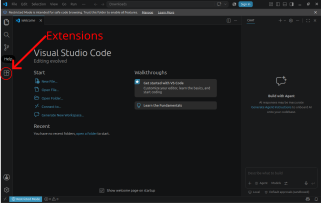

# Data Science in der Humanbiologie - Python Data Science Kurs

Willkommen zum Python Kurs Data Science in der Humanbiologie.

In diesem Kurs verwenden wir Python, um biologische Daten zu analysieren, zu visualisieren und wissenschaftlich auszuwerten.

Wir arbeiten mit:

- **Python** – Programmiersprache für Datenanalyse
- **Visual Studio Code (VS Code)** – Entwicklungsumgebung
- **Jupyter Notebooks** – interaktive Umgebung für Datenanalyse
- **Git** – zum Herunterladen und Aktualisieren der Kursmaterialien
- **uv** – Verwaltung der Python-Umgebung und benötigten Pakete

Die Installation muss nur **einmal vor Beginn des Praktikums** durchgeführt werden.

Bitte führe alle Schritte genau in der angegebenen Reihenfolge durch.

---

# Übersicht

Nach erfolgreicher Installation sieht dein Arbeitsablauf so aus:

```
GitHub Repository
        |
        ↓
Visual Studio Code
        |
        ↓
Python Umgebung (.venv)
        |
        ↓
Jupyter Notebook
        |
        ↓
Datenanalyse
```

---


# Voraussetzungen

Du benötigst:

☑ Computer mit Windows, macOS oder Linux
☑ Internetverbindung
☑ GitHub-Account (für den Zugriff auf die Kursmaterialien)

Installiert werden:

☑ Visual Studio Code
☑ Git
☑ uv
☑ benötigte VS-Code-Erweiterungen

Die Python-Version und alle Python-Pakete werden automatisch durch `uv` verwaltet.


# Schritt 1 - Visual Studio Code installieren

Lade Visual Studio Code herunter:

[Visual Studio Code](https://code.visualstudio.com/)

Installiere VS Code mit den Standardeinstellungen.

Öffne VS Code nach der Installation einmal, um sicherzustellen, dass es funktioniert.

---

# Schritt 2 - Git installieren

Git benötigen wir, um die Kursmaterialien herunterzuladen und später zu aktualisieren.

Download:

[Git](https://git-scm.com/downloads)

Installiere Git mit den Standardeinstellungen.

---

## Git testen

Öffne ein Terminal.

### Windows

Öffne:

```
Startmenü → PowerShell
```

### macOS

Öffne:

```
Programme → Dienstprogramme → Terminal
```

### Linux

Öffne dein Terminal.

Gib ein:

```bash
git --version
```

Du solltest eine Ausgabe ähnlich dieser sehen:

```
git version 2.x.x
```

Wenn eine Versionsnummer erscheint, ist Git erfolgreich installiert.

---

# Schritt 3 - Python installieren

Wir verwenden Python Version 3.13. Falls nicht vorhanden:

Download:

[Python](https://www.python.org/downloads/)

Installiere Python 3.13.

## ⚠️ Wichtig für Windows: Python zum PATH hinzufügen

Beim Start des Python-Installers erscheint das erste Installationsfenster.

Unten im Fenster befindet sich eine Checkbox:

```
☑ Add python.exe to PATH
```

Diese Checkbox **muss aktiviert werden**, bevor du die Installation startest.

Danach kannst du auf:

```
Install Now
```

klicken.

---

### Warum ist das wichtig?

Die PATH-Einstellung ermöglicht es Windows, Python über das Terminal zu finden.

Ohne diese Einstellung funktioniert später beispielsweise:

```bash
python --version
```

nicht.

---

### Falls du die Option vergessen hast

Keine Panik.

Du kannst Python erneut installieren:

1. Öffne den Python Installer erneut
2. Wähle:

```
Modify
```

oder:

```
Repair
```

3. Aktiviere:

```
Add python.exe to PATH
```

4. Schließe die Installation ab


## Python testen

Öffne ein neues Terminal und gib ein:

```bash
python --version
```

Erwartete Ausgabe:

```
Python 3.13.x
```

Wenn diese Ausgabe erscheint, ist Python korrekt installiert.

---

# Schritt 4 - uv installieren

`uv` verwaltet die komplette Python-Umgebung für diesen Kurs.

Es:

* installiert die richtige Python-Version
* erstellt eine isolierte Umgebung
* installiert alle benötigten Pakete
* sorgt dafür, dass alle Studierenden dieselbe Umgebung verwenden

---

## Windows

Öffne PowerShell:

```powershell
winget install --id=astral-sh.uv
```

---

## macOS und Linux

Öffne ein Terminal:

```bash
curl -LsSf https://astral.sh/uv/install.sh | sh
```

Falls unter Linux `curl` fehlt:

```bash
sudo apt install curl -y
```

---

Schließe danach das Terminal vollständig und öffne ein neues Terminal.

Teste:

```bash
uv --version
```

Beispiel:

```
uv 0.x.x
```

---


# Schritt 5 - VS Code Erweiterungen installieren

Öffne VS Code.

Klicke links auf das Symbol "Extensions":




Installiere die folgenden Erweiterungen:


| Erweiterung | Publisher | Extension ID (Suchbegriff) | Zweck |
|---|---|---|---|
| Python | Microsoft | `ms-python.python` | Python-Unterstützung, Interpreter auswählen, Ausführen von Python-Code |
| Jupyter | Microsoft | `ms-toolsai.jupyter` | Öffnen und Ausführen von Jupyter Notebooks (`.ipynb`) |
| Data Wrangler | Microsoft | `ms-toolsai.datawrangler` | Interaktive Untersuchung und Aufbereitung von Datensätzen |
| Ruff | Astral Software | `charliermarsh.ruff` | Automatische Code-Analyse und Formatierung |

---


# Schritt 6 - Kursmaterialien herunterladen

Öffne ein Terminal.

Wechsle an den Ort, an dem du den Kurs speichern möchtest.

Beispiel:

```bash
cd Documents
```

Lade das Repository herunter:

```bash
git clone https://github.com/MarcoMernberger/human-biology-python.git
```

Wechsle in den Kursordner:

```bash
cd human-biology-python
```

Prüfe den Inhalt:

```bash
ls
```

Du solltest unter anderem sehen:

```
README.md
pyproject.toml
uv.lock
notebooks
data
```

---


# Schritt 7 - Python-Umgebung erstellen

Im Kursordner führst du aus:

```bash
uv sync
```

Dieser Befehl:

- erstellt eine eigene Python-Umgebung
- installiert alle benötigten Python-Pakete
- installiert exakt die Versionen, die im Kurs verwendet werden

Die erste Installation kann einige Minuten dauern.

Nach erfolgreicher Installation existiert ein neuer Ordner:

```
.venv
```

Dieser Ordner enthält deine Kursumgebung.

Bitte lösche oder verändere diesen Ordner nicht.

---

# Schritt 8 - Kurs in VS Code öffnen

Im Terminal:

```bash
code .
```

Alternativ:

1. Öffne VS Code
2. Wähle:

```
Datei → Ordner öffnen
```

3. Wähle:

```
human-biology-python
```

---

# Schritt 9 - Python-Umgebung in VS Code auswählen

VS Code muss wissen, welche Python-Version verwendet werden soll.

Drücke:

## Windows/Linux

```
Ctrl + Shift + P
```

## macOS

```
Cmd + Shift + P
```

Suche:

```
Python: Select Interpreter
```

Wähle:

```
Python 3.13 (.venv)
```

bzw. den Interpreter aus dem Ordner:

```
.venv
```

---

# Schritt 10 - Installation testen

Öffne:

```
notebooks/00_setup_test.ipynb
```

Oben rechts im Notebook:

Wähle den Kernel:

```
Python (.venv)
```

Klicke anschließend:

```
Run All
```

Das Notebook sollte ohne Fehlermeldungen durchlaufen.

Am Ende muss die grüne Erfolgsmeldung erscheinen und der Testplot muss sichtbar sein.

Wenn du die Grafik siehst:

🎉 Deine Python-Umgebung ist erfolgreich eingerichtet.

---

# Arbeiten während des Kurses

## Notebook öffnen

Die Kursübungen befinden sich in Dateien mit der Endung:

```
.ipynb
```

Diese Dateien werden direkt in VS Code geöffnet.

Code wird über die ▶-Schaltfläche ausgeführt.

---

# Kursmaterialien aktualisieren

Wenn neue Materialien bereitgestellt werden:

Öffne ein Terminal im Kursordner und führe aus:

```bash
git pull
```

---

# Python-Pakete aktualisieren

Falls der Dozent dazu auffordert:

```bash
uv sync
```

---

# Wichtige Regeln

## Keine Pakete selbst installieren

Bitte nicht verwenden:

```bash
pip install paketname
```

Die Kursumgebung wird automatisch über:

```
pyproject.toml
```

und

```
uv.lock
```

verwaltet.

Manuelle Installationen können zu Problemen führen.

---

## Den Ordner .venv nicht löschen

Der Ordner:

```
.venv
```

enthält deine persönliche Python-Umgebung für diesen Kurs.

---

# Fehlerbehebung

## Problem: Python wird nicht gefunden

Teste:

```bash
python --version
```

Falls dies nicht funktioniert:

- Terminal schließen und neu öffnen
- Computer neu starten
- Python erneut installieren
- unter Windows prüfen, ob "Add Python to PATH" aktiviert wurde

---

## Problem: VS Code findet Python nicht

Öffne die Befehlspalette:

Windows/Linux:

```
Ctrl + Shift + P
```

macOS:

```
Cmd + Shift + P
```

Wähle:

```
Python: Select Interpreter
```

und anschließend:

```
.venv
```

---

## Problem: Etwas funktioniert nicht

Versuche zuerst:

```bash
uv sync
```

und starte VS Code neu.

Falls das Problem weiterhin besteht, notiere:

1. Betriebssystem:
   - Windows
   - macOS
   - Linux

2. Den ausgeführten Befehl

3. Die vollständige Fehlermeldung

---

# Checkliste vor Beginn des Praktikums

Vor dem Praktikum sollte alles Folgende erledigt sein:

☑ VS Code installiert  
☑ Git installiert  
☑ Python 3.13 installiert  
☑ uv installiert  
☑ Python VS Code Extension installiert  
☑ Jupyter VS Code Extension installiert  
☑ Kursrepository heruntergeladen  
☑ `uv sync` erfolgreich ausgeführt  
☑ Test-Notebook erfolgreich ausgeführt  

Du bist jetzt bereit für den Kurs!