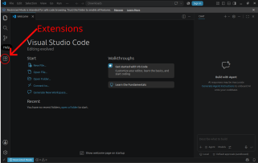
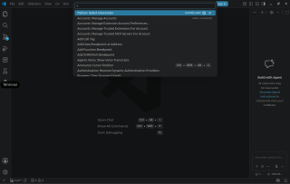
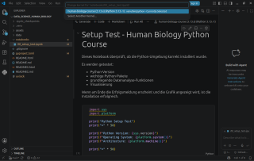

# Data Science in Human Biology - Python Data Science Course

Welcome to the Python course **Data Science in Human Biology**.

In this course, we use Python to analyze, visualize, and scientifically evaluate biological data.

We work with:

- **Python** – programming language for data analysis
- **Visual Studio Code (VS Code)** – development environment
- **Jupyter Notebooks** – interactive environment for data analysis
- **Git** – for downloading and updating course materials
- **uv** – management of the Python environment and required packages

The installation only needs to be performed **once before the practical course starts**.

Please follow all steps in the order given.

---

# Overview

After successful installation, your workflow will look like this:

```
GitHub Repository
        |
        ↓
Visual Studio Code
        |
        ↓
Python Umgebung (`.venv`)
        |
        ↓
+----------------+
|                |
VS Code      JupyterLab
|                |
+----------------+
        |
        ↓
Datenanalyse
```

---


# Requirements

You need:

☑ Computer running Windows, macOS, or Linux  
☑ Internet connection  

The following software will be installed:

☑ Visual Studio Code  
☑ Git  
☑ uv  
☑ Required VS Code extensions  

The Python version and all Python packages are automatically managed by `uv`.

---

# Step 1 - Install Visual Studio Code

Download Visual Studio Code:

[Visual Studio Code](https://code.visualstudio.com/)

Install VS Code using the default settings.

Open VS Code once after installation to make sure it works correctly.

---

# Step 2 - Install Git

Git is required to download the course materials and update them later.

Download Git:

[Git](https://git-scm.com/downloads)

Install Git using the default settings.

---

## Test Git installation

Open a terminal.

### Windows

Open:

```
Start Menu → PowerShell
```

### macOS

Open:

```
Applications → Utilities → Terminal
```

### Linux

Öffne dein Terminal.

Gib ein:

```bash
git --version
```

You should see output similar to:

```
git version 2.x.x
```

If a version number appears, Git has been installed successfully.

---

# Step 3 - Install uv

uv manages the complete Python environment for this course.

It:

* installs the correct Python version
* creates an isolated environment
* installs all required packages
* ensures that all students use the same environment
  
---

## Windows

Open PowerShell:

```powershell
winget install --id=astral-sh.uv
```

---

## macOS und Linux

Open a terminal:

```bash
curl -LsSf https://astral.sh/uv/install.sh | sh
```

If `curl` is missing on Linux:

```bash
sudo apt install curl -y
```

---

Close the terminal completely and open a new terminal.

Test the installation:

```bash
uv --version
```

Beispiel:

```
uv 0.x.x
```

---

# Step 4 - Install VS Code Extensions

Open VS Code.

Click the "Extensions" icon on the left:



Install the following extensions:


| Extension | Publisher | Extension ID (Search for) | Purpose |
|---|---|---|---|
| Python | Microsoft | `ms-python.python` | Python-Unterstützung, Interpreter auswählen, Ausführen von Python-Code |
| Jupyter | Microsoft | `ms-toolsai.jupyter` | Öffnen und Ausführen von Jupyter Notebooks (`.ipynb`) |
| Data Wrangler | Microsoft | `ms-toolsai.datawrangler` | Interaktive Untersuchung und Aufbereitung von Datensätzen |
| Ruff | Astral Software | `charliermarsh.ruff` | Automatische Code-Analyse und Formatierung |

---


# Step 5 - Download Course Materials

Open a terminal.

Navigate to the location where you want to store the course materials.

Example:

```bash
cd Documents
```

Download the repository:

```bash
git clone https://github.com/MarcoMernberger/data_science_human_biology.git
```

Change into the course directory:

```bash
cd data_science_human_biology
```

Check the contents:

Linux or macOS:

```bash
ls -al
```

Windows:

```powershell
dir
```

You should see files and folders including:

```
README.md
pyproject.toml
uv.lock
notebooks
data
```

---


# Step 6 - Create the Python Environment

Inside the course directory, run:

```bash
uv sync
```

This command:

- creates a dedicated Python environment
- installs all required Python packages
- installs exactly the versions used in the course

The first installation may take several minutes.

After successful installation, a new folder exists:

```
.venv
```

This folder contains your course environment.

Please do not delete or modify this folder.

---

# Step 7 - Open the Course in VS Code

In the terminal:

```bash
code .
```

Alternatively:

1. Open VS Code
2. Select:

```
File → Open Folder
```

3. Choose:

```
data_science_human_biology
```

---

# Step 8 - Select the Python Environment in VS Code

VS Code needs to know which Python version should be used.

Press:

## Windows/Linux

```
Ctrl + Shift + P
```

## macOS

```
Cmd + Shift + P
```

Search for:

```
Python: Select Interpreter
```

Select:

```
Python 3.13 (`.venv`)
```

or the interpreter located inside:

```
.venv
```



---

# Step 9 - Test JupyterLab

Depending on the number of installed extensions and available resources, VS Code can use a considerable amount of system resources.

If VS Code runs slowly on your computer, the course can also be completed directly using JupyterLab.

JupyterLab runs in your web browser and requires fewer resources than a full development environment.


## Start JupyterLab

Open a terminal inside the course directory:

```bash
uv run jupyter lab
```

A browser window with JupyterLab will open automatically.

If no browser opens automatically, copy the displayed URL into your browser.

Example:

[http://localhost:8888/lab](http://localhost:8888/lab)

## Stop JupyterLab

In the terminal press:

`Ctrl + C`

---


# Step 10 - Test the Installation

Open:

```
notebooks/00_setup_test.ipynb
```

In the upper right corner of the notebook:

Select the kernel:

```
Python (`.venv`)
```




Then click:

```
Run All
```

The notebook should run without errors.

At the end, a green success message should appear and the test plot should be visible.

If you can see the plot:

🎉 Your Python environment has been successfully configured.

---


# Working During the Course

# Opening notebooks

The course exercises are provided as files with the extension:

```
.ipynb
```

These files can be opened directly in VS Code.

Code can be executed using the ▶ button.

---

# Updating Course Materials

If new or updated materials are provided:

Open a terminal inside the course directory and run:

```bash
git pull
```

---

# Updating Python Packages

The course environment is centrally managed using pyproject.toml and uv.lock.

If new Python packages are added to the course, they will be provided through the course repository.

After updating the course materials:

```bash
git pull
uv sync
```

# Adding Your Own Python Packages

If you later want to install additional packages, use:

```bash
uv add <package>
```

This automatically updates pyproject.toml und uv.lock.

If you develop your own project and want to share it with others, both files must be included:

```
pyproject.toml
uv.lock
```

---

# Important Rules

## Do not install packages using other methods

Please do not use:

```bash
pip install <package>
```

The course environment is managed automatically through:

```
pyproject.toml
```

and

```
uv.lock
```

Manual installations may cause compatibility problems.

---

## Do not delete the .venv folder

The folder:

```
.venv
```

contains your personal Python environment for this course.

---

# Troubleshooting

## Problem: VS Code cannot find Python

Open the Command Palette:

Windows/Linux:

```
Ctrl + Shift + P
```

macOS:

```
Cmd + Shift + P
```

SSelect:

```
Python: Select Interpreter
```

and choose:

```
.venv
```

---

## Problem: Something does not work

Try first:

```bash
uv sync
```

uand restart VS Code.

If the problem persists, note:

1. Operating system:
   - Windows
   - macOS
   - Linux

2. The command you executed

3. The complete error message

---

# Checklist Before the Practical Course

Before the course starts, the following should be completed:

☑ VS Code installed

☑ Git installed

☑ uv installed

☑ Python VS Code extension installed

☑ Jupyter VS Code extension installed

☑ Course repository downloaded

☑ uv sync completed successfully

☑ VS Code and JupyterLab started once

☑ Test notebook executed successfully

You are now ready for the course!