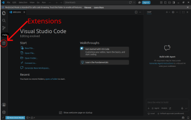
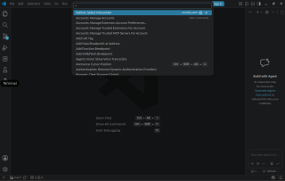
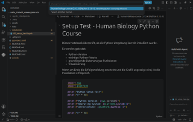

# Data Science in Human Biology - Python-Kurs zur Datenanalyse

Willkommen im Python-Kurs **Data Science in Human Biology**.

In diesem Kurs verwenden wir Python, um biologische Daten zu analysieren, zu visualisieren und wissenschaftlich zu bewerten.

Wir arbeiten mit:

- **Python** – Programmiersprache für die Datenanalyse
- **Visual Studio Code (VS Code)** – Entwicklungsumgebung
- **Jupyter Notebooks** – interaktive Umgebung für die Datenanalyse
- **Git** – zum Herunterladen und Aktualisieren der Kursmaterialien
- **uv** – Verwaltung der Python-Umgebung und der benötigten Pakete

Die Installation muss nur **einmal vor Beginn des Praktikums** durchgeführt werden.

Bitte befolge alle Schritte in der angegebenen Reihenfolge.

---

# Überblick

Nach erfolgreicher Installation sieht dein Arbeitsablauf so aus:

```
GitHub Repository
        |
        ↓
Visual Studio Code
        |
        ↓
Python-Umgebung (`.venv`)
        |
        ↓
+----------------+
|                |
VS Code      JupyterLab
|                |
+----------------+
        |
        ↓
Datenanalyse
```

---


# Voraussetzungen

Du benötigst:

☑ Einen Computer mit Windows, macOS oder Linux  
☑ Internetverbindung (für die Installation; die Kursnotebooks selbst funktionieren offline)

Folgende Software wird installiert:

☑ Visual Studio Code  
☑ Git  
☑ uv  
☑ Benötigte VS-Code-Erweiterungen  

Die Python-Version und alle Python-Pakete werden automatisch von `uv` verwaltet.

---

# Schritt 1 - Visual Studio Code installieren

Lade Visual Studio Code herunter:

[Visual Studio Code](https://code.visualstudio.com/)

Installiere VS Code mit den Standardeinstellungen.

Öffne VS Code nach der Installation einmal, um sicherzustellen, dass es korrekt funktioniert.

---

# Schritt 2 - Git installieren

Git wird benötigt, um die Kursmaterialien herunterzuladen und später zu aktualisieren.

Lade Git herunter:

[Git](https://git-scm.com/downloads)

Installiere Git mit den Standardeinstellungen.

Unter Linux kannst du Git auch mit deinem Paketmanager installieren, zum Beispiel unter Ubuntu oder Debian:

```bash
sudo apt install git -y
```

---

## Git-Installation testen

Öffne ein Terminal.

### Windows

Öffne:

```
Startmenü → PowerShell
```

### macOS

Öffne:

```
Programme → Dienstprogramme → Terminal
```

### Linux

Öffne dein Terminal.

Gib ein:

```bash
git --version
```

Du solltest eine Ausgabe ähnlich wie diese sehen:

```
git version 2.x.x
```

Wenn eine Versionsnummer erscheint, wurde Git erfolgreich installiert.

---

# Schritt 3 - uv installieren

uv verwaltet die komplette Python-Umgebung für diesen Kurs.

uv:

* installiert die passende Python-Version
* erstellt eine isolierte Umgebung
* installiert alle benötigten Pakete
* stellt sicher, dass alle Teilnehmenden dieselbe Umgebung verwenden

---

## Windows

Öffne PowerShell und führe aus:

```powershell
powershell -ExecutionPolicy ByPass -c "irm https://astral.sh/uv/install.ps1 | iex"
```

Falls das nicht funktioniert, kannst du stattdessen `winget` versuchen:

```powershell
winget install --id=astral-sh.uv -e
```

---

## macOS und Linux

Öffne ein Terminal:

```bash
curl -LsSf https://astral.sh/uv/install.sh | sh
```

Falls `curl` unter Linux (Ubuntu oder Debian) fehlt:

```bash
sudo apt install curl -y
```

---

Schließe das Terminal vollständig und öffne ein neues Terminal.

Teste die Installation:

```bash
uv --version
```

Beispiel:

```
uv 0.x.x
```

---

# Schritt 4 - VS-Code-Erweiterungen installieren

Öffne VS Code.

Klicke links auf das Symbol "Erweiterungen" (Extensions):



Installiere die folgenden Erweiterungen:


| Erweiterung | Herausgeber | Erweiterungs-ID (danach suchen) | Zweck |
|---|---|---|---|
| Python | Microsoft | `ms-python.python` | Python-Unterstützung, Interpreter auswählen, Ausführen von Python-Code |
| Jupyter | Microsoft | `ms-toolsai.jupyter` | Öffnen und Ausführen von Jupyter Notebooks (`.ipynb`) |
| Data Wrangler | Microsoft | `ms-toolsai.datawrangler` | Interaktive Untersuchung und Aufbereitung von Datensätzen |
| Ruff | Astral Software | `charliermarsh.ruff` | Automatische Code-Analyse und Formatierung |

---


# Schritt 5 - Kursmaterialien herunterladen

Öffne ein Terminal.

Navigiere zu dem Ort, an dem du die Kursmaterialien speichern möchtest.

Beispiel:

```bash
cd Documents
```

Lade das Repository herunter:

```bash
git clone https://github.com/MarcoMernberger/data_science_human_biology.git
```

Wechsle in das Kursverzeichnis:

```bash
cd data_science_human_biology
```

Überprüfe den Inhalt:

Linux oder macOS:

```bash
ls -al
```

Windows:

```powershell
dir
```

Du solltest unter anderem folgende Dateien und Ordner sehen:

```
README.md
pyproject.toml
uv.lock
notebooks
data
assets
outputs
```

---


# Schritt 6 - Python-Umgebung erstellen

Führe im Kursverzeichnis aus:

```bash
uv sync
```

Dieser Befehl:

- erstellt eine eigene Python-Umgebung
- installiert alle benötigten Python-Pakete
- installiert genau die Versionen, die im Kurs verwendet werden

Die erste Installation kann einige Minuten dauern.

Nach erfolgreicher Installation gibt es einen neuen Ordner:

```
.venv
```

Dieser Ordner enthält deine Kursumgebung.

Bitte lösche oder verändere diesen Ordner nicht.

---

# Schritt 7 - Den Kurs in VS Code öffnen

Im Terminal:

```bash
code .
```

Alternativ:

1. Öffne VS Code
2. Wähle:

```
Datei → Ordner öffnen
```

(englisch: `File → Open Folder`)

3. Wähle:

```
data_science_human_biology
```

---

# Schritt 8 - Python-Umgebung in VS Code auswählen

VS Code muss wissen, welche Python-Version verwendet werden soll.

Drücke:

## Windows/Linux

```
Strg + Umschalt + P
```

## macOS

```
Cmd + Umschalt + P
```

Suche nach:

```
Python: Select Interpreter
```

Falls dein VS Code auf Deutsch eingestellt ist, heißt der Befehl `Python: Interpreter auswählen`.

Wähle den Eintrag, der zum `.venv`-Ordner des Kurses gehört, zum Beispiel:

```
Python 3.12.x (.venv)
```

oder

```
Python 3.13.x (.venv)
```

Die genaue Versionsnummer spielt keine Rolle, solange `.venv` Teil des Eintrags ist.



---

# Schritt 9 - JupyterLab testen

Je nach Anzahl der installierten Erweiterungen und den verfügbaren Ressourcen kann VS Code viele Systemressourcen verbrauchen.

Falls VS Code auf deinem Computer langsam läuft, kannst du den Kurs auch direkt mit JupyterLab absolvieren.

JupyterLab läuft in deinem Webbrowser und benötigt weniger Ressourcen als eine vollständige Entwicklungsumgebung.


## JupyterLab starten

Öffne ein Terminal im Kursverzeichnis:

```bash
uv run jupyter lab
```

Es öffnet sich automatisch ein Browserfenster mit JupyterLab.

Falls sich kein Browser automatisch öffnet, kopiere die angezeigte URL in deinen Browser.

Beispiel:

[http://localhost:8888/lab](http://localhost:8888/lab)

In JupyterLab ist der Kernel `Python 3 (ipykernel)` der richtige, weil JupyterLab mit `uv run` gestartet wurde.

## JupyterLab beenden

Drücke im Terminal:

`Strg + C`

---


# Schritt 10 - Installation testen

Öffne:

```
notebooks/00_setup_test.ipynb
```

Klicke in VS Code oben rechts im Notebook auf "Select Kernel" (Kernel auswählen) und wähle den Eintrag, der zu `.venv` gehört:

```
Python Environments... → Python 3.x.x (.venv)
```




Klicke dann auf:

```
Run All
```

(deutsch: "Alle ausführen")

Das Notebook sollte ohne Fehler durchlaufen.

Am Ende sollte eine Erfolgsmeldung erscheinen und die Testgrafik sichtbar sein.

Wenn du die Grafik siehst:

🎉 Deine Python-Umgebung wurde erfolgreich eingerichtet.

---


# Arbeiten während des Kurses

## Notebooks öffnen

Die Kursnotebooks werden als Dateien mit der Endung

```
.ipynb
```

bereitgestellt.

Diese Dateien kannst du direkt in VS Code oder in JupyterLab öffnen.

Code kannst du mit der ▶-Schaltfläche ausführen.

## In einer eigenen Kopie arbeiten

Bitte arbeite **nicht** direkt im Ordner `notebooks`. Sonst können deine Änderungen mit Aktualisierungen der Kursmaterialien kollidieren (siehe "Kursmaterialien aktualisieren" weiter unten).

Kopiere stattdessen den Ordner des jeweiligen Tages in den Ordner `my_work` und arbeite dort. Zum Beispiel für Tag 1:

Linux oder macOS:

```bash
mkdir -p my_work
cp -r notebooks/day01 my_work/
```

Windows (PowerShell):

```powershell
New-Item -ItemType Directory -Force my_work
Copy-Item -Recurse notebooks\day01 my_work\
```

Du kannst den Ordner auch im VS-Code-Explorer kopieren und einfügen.

Wichtig:

- Behalte die Ordnerstruktur bei: `my_work/day01`, nicht direkt `my_work`. Die Notebooks laden ihre Daten über relative Pfade (`../../data/...`), die nur in dieser Ordnertiefe funktionieren.
- Der Ordner `my_work` wird von Git ignoriert. Deine eigene Arbeit wird durch Updates nie verändert oder gelöscht.
- Mache dasselbe mit dem Ordner `notebooks/practice`, wenn du die Übungsaufgaben bearbeiten möchtest.

---

# Kursmaterialien aktualisieren

Wenn neue oder aktualisierte Materialien bereitgestellt werden:

Öffne ein Terminal im Kursverzeichnis und führe aus:

```bash
git pull
```

---

# Python-Pakete aktualisieren

Die Kursumgebung wird zentral über `pyproject.toml` und `uv.lock` verwaltet.

Wenn dem Kurs neue Python-Pakete hinzugefügt werden, werden sie über das Kurs-Repository bereitgestellt.

Nach dem Aktualisieren der Kursmaterialien:

```bash
git pull
uv sync
```

# Eigene Python-Pakete hinzufügen

Bitte füge während des Kurses keine Pakete selbst hinzu. Alle Teilnehmenden müssen genau dieselbe Umgebung haben.

Wenn du später für eigene Projekte zusätzliche Pakete verwenden möchtest, lege einen separaten Projektordner außerhalb des Kursordners an und nutze dort `uv`:

```bash
uv init my_project
cd my_project
uv add <paket>
```

`uv add` aktualisiert automatisch `pyproject.toml` und `uv.lock` dieses Projekts.

Wenn du dein eigenes Projekt mit anderen teilst, müssen beide Dateien enthalten sein:

```
pyproject.toml
uv.lock
```

---

# Wichtige Regeln

## Installiere keine Pakete auf anderem Weg

Bitte verwende nicht:

```bash
pip install <paket>
```

Die Kursumgebung wird automatisch verwaltet über:

```
pyproject.toml
```

und

```
uv.lock
```

Manuelle Installationen können Kompatibilitätsprobleme verursachen.

---

## Lösche den Ordner .venv nicht

Der Ordner:

```
.venv
```

enthält deine persönliche Python-Umgebung für diesen Kurs.

---

# Fehlerbehebung

## Problem: VS Code findet Python nicht

Öffne die Befehlspalette:

Windows/Linux:

```
Strg + Umschalt + P
```

macOS:

```
Cmd + Umschalt + P
```

Wähle:

```
Python: Select Interpreter
```

(deutsch: `Python: Interpreter auswählen`)

und wähle den Eintrag, der zu folgendem Ordner gehört:

```
.venv
```

---

## Problem: Ein Notebook findet eine Datendatei nicht (`FileNotFoundError`)

Die Notebooks laden ihre Daten über relative Pfade. Prüfe, ob sich deine Kopie in der richtigen Ordnertiefe befindet, zum Beispiel `my_work/day01/` und nicht direkt in `my_work/`.

---

## Problem: `git pull` meldet "Your local changes would be overwritten"

Du hast eine Datei im Ordner `notebooks` verändert. Kopiere dein verändertes Notebook zuerst in deinen Ordner `my_work` (siehe "In einer eigenen Kopie arbeiten"). Führe dann aus:

```bash
git restore notebooks
git pull
```

---

## Problem: Etwas funktioniert nicht

Versuche zuerst:

```bash
uv sync
```

und starte VS Code neu.

Wenn das Problem weiterhin besteht, notiere:

1. Betriebssystem:
   - Windows
   - macOS
   - Linux

2. Den Befehl, den du ausgeführt hast

3. Die vollständige Fehlermeldung

---

# Checkliste vor Beginn des Praktikums

Vor Kursbeginn sollte Folgendes erledigt sein:

☑ VS Code installiert

☑ Git installiert

☑ uv installiert

☑ Python-Erweiterung für VS Code installiert

☑ Jupyter-Erweiterung für VS Code installiert

☑ Kurs-Repository heruntergeladen

☑ uv sync erfolgreich abgeschlossen

☑ VS Code und JupyterLab einmal gestartet

☑ Testnotebook erfolgreich ausgeführt

Du bist jetzt bereit für den Kurs!
